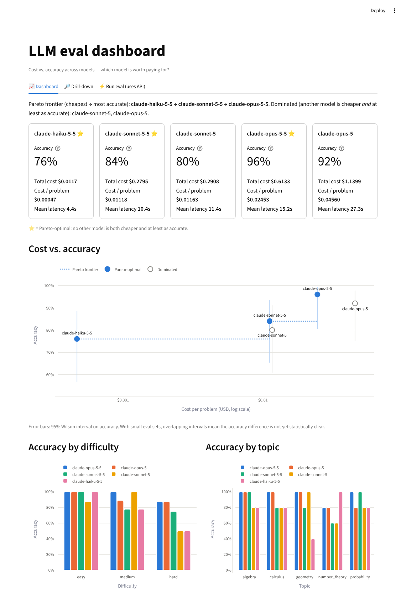
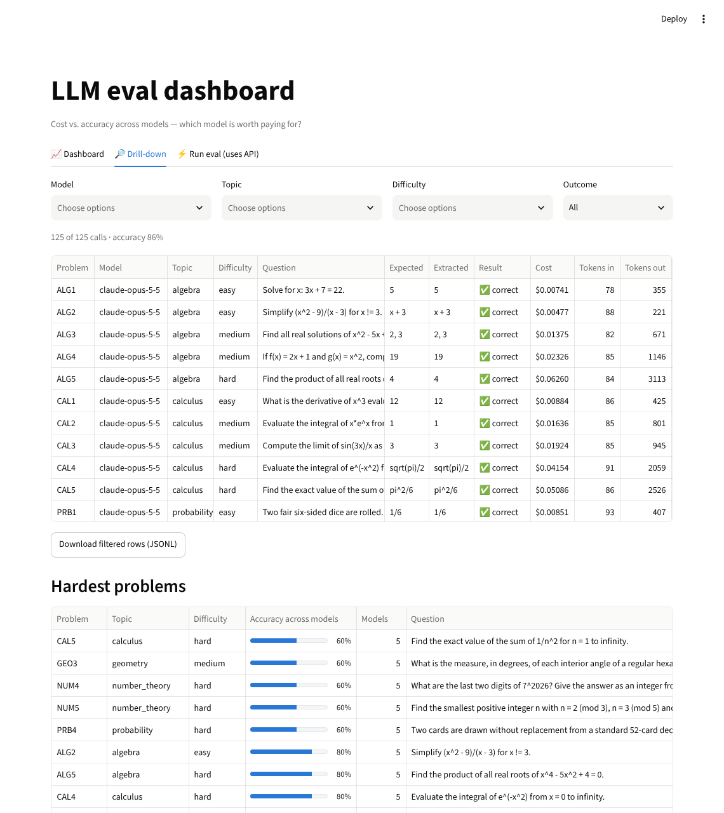

# LLM eval dashboard

A Streamlit dashboard that turns raw LLM evaluation results into a **cost-vs-accuracy story**
a hiring team, PM or engineer can read in ten seconds: which models sit on the Pareto
frontier, which are dominated, and where each one fails.

It runs out of the box on bundled synthetic data — **no API key needed** — and has an optional,
clearly separated tab that runs a tiny live eval against the Claude API.



## What it shows

| View | What you learn |
|---|---|
| **Headline + KPI cards** | Per model: accuracy (with 95% Wilson interval on hover), total cost, cost per problem, mean latency. ⭐ marks Pareto-optimal models. |
| **Cost vs. accuracy (Pareto)** | One labelled point per model, x = cost per problem (log scale), y = accuracy. The frontier staircase joins the models no other model beats on *both* price and accuracy; dominated models are hollow grey. Error bars show the 95% Wilson interval, so you can see when a difference is just noise. |
| **Accuracy by difficulty / by topic** | Grouped bars per model — where the cheap model is good enough, and where only the big one holds up. |
| **Cost breakdown** | Stacked input-token vs output-token cost per model. Output (including thinking tokens) dominates, which is where cost control actually lives. |
| **Drill-down** | Filter by model / topic / difficulty / outcome; see each problem, the expected vs. extracted answer, correctness and cost. Plus a "hardest problems" table across models. Export filtered rows as JSONL. |
| **Upload / pick results** | Use the bundled sample or upload your own `resultados.jsonl`. |
| **Run eval (optional, uses the API)** | Runs a few bundled math problems × selected Claude models live, grades them symbolically and appends the rows to the dashboard. |

## Why cost vs. accuracy matters for model selection

Leaderboards rank by accuracy alone, but in production you pay per token on every request.
The useful question is not "which model is best?" but **"what is the cheapest model that is
accurate enough for this workload?"**:

- A model is only worth considering if it is on the **Pareto frontier** — if another model is
  cheaper *and* at least as accurate, the first one is strictly a worse deal.
- Along the frontier, each step up buys accuracy at a price. In the sample data, moving from the
  smallest to the largest model costs ~50× more per problem for +20 points of accuracy — great for
  hard problems, wasteful for easy ones (see "Accuracy by difficulty").
- Small eval sets are noisy. The confidence intervals keep you from over-reading a 4-point gap on
  25 problems.
- Newer generations frequently dominate older ones (cheaper and better), which is why re-running
  this comparison when models change pays off.

## Data format

One model call per line (the format produced by the sibling eval harness):

```json
{"id":"ALG1","topic":"algebra","difficulty":"easy","modelo":"claude-haiku-5-5","correcto":true,"costo":0.0004,"tok_in":120,"tok_out":300,"seg":1.1,"esperado":"5","extraido":"5"}
```

- **Required:** `id`, `modelo` (model), `correcto` (correct), `costo` (USD).
- **Optional:** `topic`, `difficulty`, `tok_in`, `tok_out`, `seg` (latency, seconds),
  `esperado` (expected answer), `extraido` (extracted answer). English aliases such as `model`,
  `correct`, `cost`, `expected`, `extracted` are accepted too.
- Malformed lines are reported with their line number.

`sample_results.jsonl` is **synthetic**: 25 problems × 5 Claude models, generated by
`scripts/generate_sample.py` (seeded and reproducible) from per-model skill levels, typical token
use and list prices. It exists so the dashboard renders without an API key; it is not a
benchmark result.

## Run locally

```bash
git clone https://github.com/dcrr1717/llm-eval-dashboard.git
cd llm-eval-dashboard
python -m venv .venv && source .venv/bin/activate
pip install -r requirements.txt
streamlit run app.py
```

Open http://localhost:8501. Everything except the "Run eval" tab works offline.

### Optional: live eval tab

```bash
cp .env.example .env          # then put your key in .env, or simply:
export ANTHROPIC_API_KEY=sk-ant-...
streamlit run app.py
```

The tab is guarded: it shows the number of calls and a typical / worst-case cost estimate, and
the **Run eval** button stays disabled until a key is available *and* you tick "I understand
this will spend money". You can also paste a key into the tab for the current browser session
only (it is never stored). Details:

- Models: `claude-opus-5-5` (default; override with `EVAL_MODEL`), `claude-sonnet-5-5`,
  `claude-haiku-5-5`, called through the official `anthropic` Python SDK.
- Every model runs at the same `effort` level (selectable) so the comparison is like-for-like;
  thinking stays at the models' adaptive default. Cost is computed from the response's token
  usage at list prices.
- Server-side refusal fallbacks are intentionally **not** enabled: a fallback would answer with
  a different model and mislabel the row. A refusal is recorded as an incorrect answer.
- Answers are graded by `grader.py`: it extracts the `ANSWER:` line (or `\boxed{}`), normalizes
  LaTeX, and compares with SymPy (lists compared as unordered sets, numeric tolerance as a
  fallback). Model output is screened before parsing (character and identifier allowlists,
  length and exponent caps), since SymPy's parser evaluates Python.
- New rows are appended to the dashboard (toggle in the sidebar), downloadable as JSONL, and
  logged to `results/live_results.jsonl` (git-ignored) when running locally.

## Tests

```bash
pip install -r requirements-dev.txt
pytest -q
```

Offline unit tests cover data loading and validation, the Pareto frontier (including a
brute-force property check against the definition), per-model aggregation and Wilson intervals,
the input/output cost split, the grader (including hostile inputs), the live-eval runner with a
fake client (no network), chart construction, and a headless render of the whole app without an
API key. CI runs them on every push (`.github/workflows/tests.yml`).

## Deploy free on Streamlit Community Cloud

1. Push this repo to GitHub (public or private).
2. Go to [share.streamlit.io](https://share.streamlit.io), sign in with GitHub, click
   **Create app → Deploy a public app from GitHub**.
3. Repository `dcrr1717/llm-eval-dashboard`, branch `main`, main file path `app.py`.
   Under **Advanced settings** pick Python 3.12.
4. *(Optional, only for the live tab)* In **Advanced settings → Secrets**, add
   `ANTHROPIC_API_KEY = "sk-ant-..."`. Root-level secrets are exposed as environment variables,
   which is where the app reads the key. **Note:** on a public app this lets any visitor spend
   your credits — for a portfolio deployment, leave it unset; visitors can paste their own key
   in the tab instead.
5. Click **Deploy**. Dependencies install from `requirements.txt`; the light theme comes from
   `.streamlit/config.toml`.

## Project layout

```
app.py                  Streamlit UI (dashboard, drill-down, guarded run-eval tab)
metrics.py              loading/validation, aggregation, Pareto, Wilson CI, cost split (pure, tested)
charts.py               Plotly figure builders
grader.py               answer extraction + safe SymPy equivalence check
live_eval.py            live eval runner (Anthropic SDK)
problems.jsonl          25 bundled math problems for the live tab
sample_results.jsonl    synthetic results so the app runs without a key
scripts/generate_sample.py   reproducible generator for the sample
tests/                  offline pytest suite
docs/                   screenshots
```

## Screenshots

| Dashboard | Drill-down |
|---|---|
|  |  |

To refresh them, run the app and capture the page (any screenshot tool), saving over the files in
`docs/`.

## Exact commands

```bash
# run locally (no API key needed)
pip install -r requirements.txt
streamlit run app.py

# run the tests
pip install -r requirements-dev.txt
pytest -q

# regenerate the synthetic sample
python scripts/generate_sample.py

# deploy: share.streamlit.io → Create app → repo dcrr1717/llm-eval-dashboard, branch main, file app.py → Deploy
```

**Status: portfolio-ready.** Runs out of the box on the bundled sample with no API key; tests
pass offline; no secrets are committed (`.env` and `.streamlit/secrets.toml` are git-ignored).
